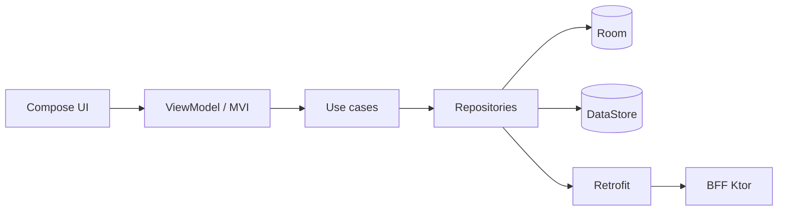

# Benefits Wallet

[](https://github.com/rodrigopupe/benewallet-android/actions/workflows/ci.yml)

Aplicativo Android nativo (Kotlin) para acompanhar o saldo e os gastos de **vale-refeição e vale-alimentação**, com extrato filtrável e metas mensais de gasto.

> Projeto desenvolvido como teste técnico para a vaga de Senior Android Software Engineer no iFood.

<!-- TODO: adicionar GIF/vídeo curto do app em funcionamento -->

## Contexto do problema

Quem recebe VR/VA costuma ter dificuldade para saber quanto ainda pode gastar no mês e para onde o dinheiro está indo. Este app mostra o saldo por benefício, um extrato navegável e permite definir metas com alertas.

O raciocínio completo (objetivos, não-objetivos, alternativas e riscos) está na [RFC 0001](docs/rfc/0001-carteira-de-beneficios.md).

## Funcionalidades

- [ ] Login simulado com biometria
- [ ] Home com saldo por benefício e últimos gastos
- [ ] Extrato com filtros (período e categoria) e paginação
- [ ] Detalhe da transação
- [ ] Metas mensais por categoria com alerta
- [ ] Funcionamento offline (cache do extrato)

<!-- TODO: marcar as funcionalidades conforme forem entregues -->

## Arquitetura



O app é um módulo único organizado em pacotes "module-like", com dependências em um só sentido:

```
app            # Application, navegação raiz, wiring do Hilt
core           # design system, rede, analytics, crash, flags, utilitários
feature
 ├── auth      # login simulado e biometria
 └── wallet    # saldo, extrato e metas
```

### Decisões de arquitetura

| ADR | Decisão |
|---|---|
| [0001](docs/adr/0001-mvi-na-camada-de-apresentacao.md) | MVI na camada de apresentação |
| [0002](docs/adr/0002-offline-first-com-room.md) | Offline-first com Room |
| [0003](docs/adr/0003-feature-flags-via-bff.md) | Feature flags fornecidas pelo BFF |
| [0004](docs/adr/0004-pacotes-module-like.md) | Pacotes "module-like" em vez de módulos Gradle |

## Stack

Kotlin, Jetpack Compose, Navigation Compose, Hilt, Room, DataStore, Retrofit/OkHttp, kotlinx.serialization, Coroutines/Flow, Sentry, Ktor (BFF).

## Como rodar

### Pré-requisitos
- JDK 21
- Android Studio (versão estável recente)
- Dispositivo ou emulador com Android 8.0 (API 26) ou superior

### Configuração

1. Copie o arquivo de exemplo e ajuste se necessário:
   ```bash
   cp local.properties.example local.properties
   ```
2. Variáveis suportadas em `local.properties` (todas opcionais):
   | Chave | Descrição | Padrão |
   |---|---|---|
   | `BFF_BASE_URL` | URL base do BFF (com `/` no final) | `http://localhost:8080/` |
   | `SENTRY_DSN` | DSN do Sentry. Vazio desativa o envio | vazio |

### BFF

```bash
./gradlew :bff:run
```

Com um dispositivo físico, redirecione a porta para o seu computador:

```bash
adb reverse tcp:8080 tcp:8080
```

No emulador, também funciona o endereço `http://10.0.2.2:8080/`.

### App

```bash
./gradlew :app:installDebug
```

<!-- TODO: confirmar o fluxo com o build variant `mock`, se for criado -->

## Qualidade e CI

- Formatação: Spotless + ktlint (`./gradlew spotlessCheck`)
- Análise estática: Detekt (`./gradlew detekt`)
- Testes unitários: `./gradlew testDebugUnitTest`
- Pipeline no GitHub Actions: formatação, análise estática, testes e build do APK debug (artefato)

## Segurança e LGPD

<!-- TODO: preencher conforme implementado -->

| Controle (OWASP MASVS) | Situação |
|---|---|
| Armazenamento seguro (Keystore) | ⏳ |
| Autenticação biométrica | ⏳ |
| Comunicação segura (TLS, pinning) | ⏳ |
| Sem dados sensíveis em logs | ⏳ |
| Minimização de dados (LGPD) | ⏳ |

## Observabilidade e métricas

- Crashes e erros: Sentry, atrás da interface `CrashReporter`
- Eventos de produto: interface `Analytics` (implementação inicial em Logcat)
- Métricas de sucesso: ver a [RFC, seção 3](docs/rfc/0001-carteira-de-beneficios.md)

## O que ficou incompleto e o que eu faria com mais tempo

<!-- TODO: preencher no final com honestidade (é um item pedido explicitamente no teste) -->

- Modularização em módulos Gradle (ADR-0004)
- Paging 3 no lugar da paginação manual
- Firebase Analytics como implementação de `Analytics`
- GraphQL no BFF
