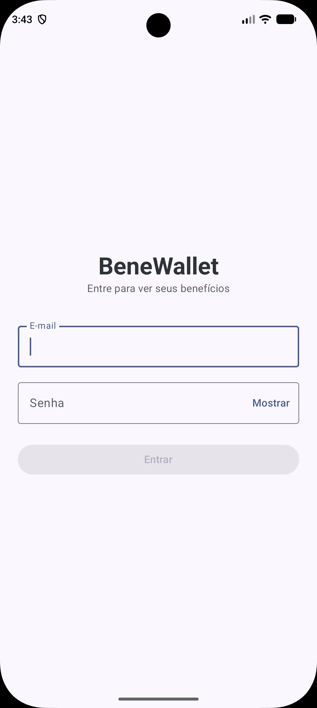
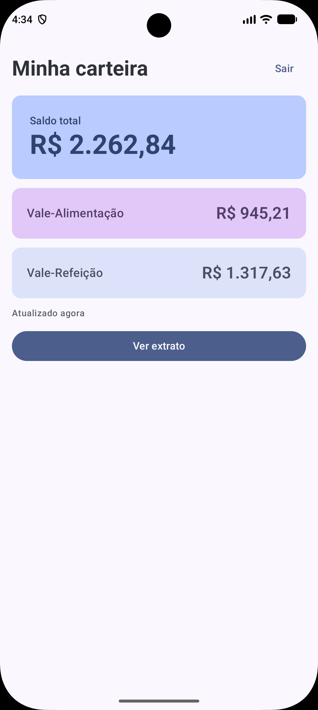
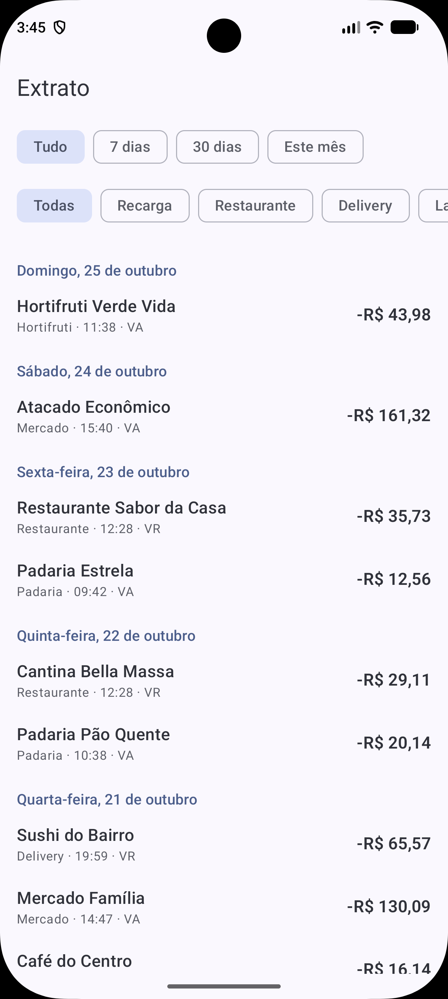
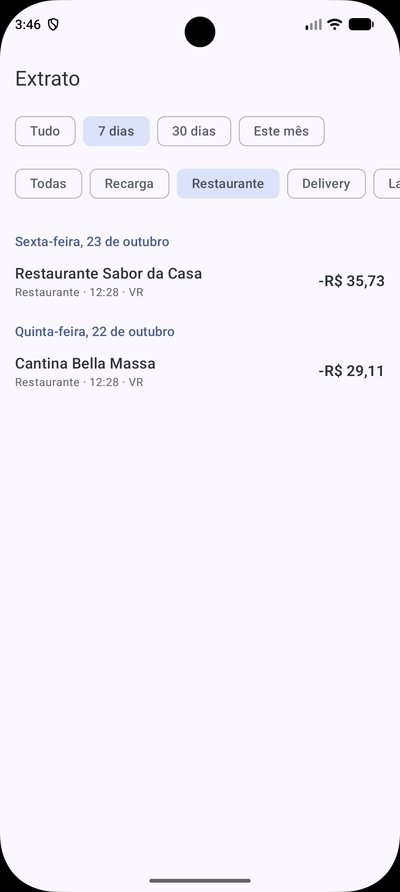
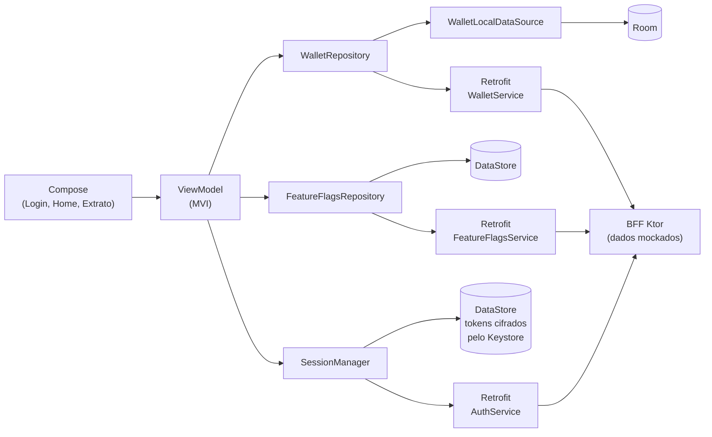

# Benefits Wallet

[](https://github.com/rodrigopupe/benewallet-android/actions/workflows/ci.yml)

Aplicativo Android nativo (Kotlin + Jetpack Compose) para acompanhar o saldo e os gastos de **vale-refeição e vale-alimentação**, com login e sessão renovável, extrato filtrável, paginação, funcionamento offline e um **BFF em Ktor** no mesmo repositório (dados mockados).

> Projeto desenvolvido como teste técnico para a vaga de Senior Android Software Engineer no iFood.

| Login | Home | Extrato | Extrato filtrado |
|---|---|---|---|
|  |  |  |  |

## Contexto do problema

Quem recebe VR/VA costuma ter dificuldade para saber quanto ainda pode gastar no mês e para onde o dinheiro está indo. O app mostra o saldo por benefício e um extrato navegável, e continua útil sem internet.

O raciocínio completo (objetivos, não-objetivos, alternativas e riscos) está na [RFC 0001](docs/rfc-0001-carteira-de-beneficios.md). O que foi cortado em relação a ela está em [RFC x entregue](#rfc-x-entregue).

## Como rodar

Pré-requisitos: JDK 21, Android Studio recente e um emulador ou aparelho com Android 8.0 (API 26) ou superior.

```bash
# Terminal 1: BFF em http://localhost:8080
./gradlew :bff:run
```

```bash
# Terminal 2: faz o emulador (ou aparelho) enxergar o BFF no seu computador
adb reverse tcp:8080 tcp:8080
```

```bash
# Instala o app (com o emulador ou aparelho conectado)
./gradlew :app:installDebug
```

Ao abrir o app, entre com uma das contas de demonstração (a senha das duas é `benewallet123`): `rodrigo@benewallet.demo` ou `bruno@benewallet.demo`. Cada conta tem os próprios dados.

A URL padrão do app é `http://localhost:8080/`, então o `adb reverse` serve tanto o emulador quanto um aparelho físico. O APK debug gerado pela CI (artefato `app-debug-apk`) também funciona com o `adb reverse`, porque na CI não há `local.properties` e vale o padrão.

Configuração opcional: copie `local.properties.example` para `local.properties` (o arquivo real está no `.gitignore`).

| Chave | Descrição | Padrão |
|---|---|---|
| `BFF_BASE_URL` | URL base do BFF (com `/` no final) | `http://localhost:8080/` |
| `SENTRY_DSN` | DSN do Sentry. Sem um DSN válido o Sentry não inicializa e o app funciona normalmente | vazio |

## Funcionalidades

- **Login e sessão:** entrada com e-mail e senha. A sessão fica guardada cifrada, é renovada sozinha quando o token expira e continua ao reabrir o app.
- **Sair:** botão na Home, com confirmação. Apaga os tokens, o banco e as flags do aparelho.
- **Home:** saldo total, saldo por benefício (VR e VA), "atualizado há X", pull-to-refresh e atalho para o extrato.
- **Extrato:** lista agrupada por dia, filtros de **período** (tudo, 7 dias, 30 dias, este mês) e de **categoria**, paginação por rodapé com "tentar novamente", aviso de dados parciais e estados de vazio e carregando.
- **Offline:** o que já foi baixado continua visível sem rede. Uma falha de rede nunca esvazia o cache; o erro aparece em um snackbar.
- **Feature flags:** a flag `statement_filters` (vinda do BFF, com cache local e padrão seguro) liga e desliga os filtros do Extrato.

## Arquitetura



Módulo único organizado em pacotes "module-like", com dependências em um só sentido ([ADR-0004](docs/adr-0004-pacotes-module-like.md)):

```
app                    # Application, MainActivity, navegação raiz, wiring do Koin
core
 ├── analytics         # Analytics e AnalyticsEvent tipados (implementação em Logcat)
 ├── auth              # sessão: tokens cifrados (Keystore), interceptor e renovação no HTTP 401
 ├── common            # dispatchers e relógio injetáveis
 ├── crash             # CrashReporter (Sentry atrás da interface)
 ├── featureflags      # flags: BFF, cache no DataStore, padrões seguros
 └── network           # OkHttp, Retrofit, kotlinx.serialization
feature/auth
 └── presentation      # tela de login
feature/wallet
 ├── presentation      # telas, ViewModels, State/Intent/Effect
 ├── domain            # modelos, contrato do repositório, WalletError
 └── data              # Room, Retrofit, DTOs, mappers, repositório
```

Regras: `feature.*` → `core`, nunca o contrário; dentro da feature, `presentation → domain ← data`; as classes de domínio e dados são `internal` e só o módulo Koin da feature é público. Não há camada de use cases: os ViewModels falam direto com o repositório, porque não há regra de negócio que justifique uma camada a mais.

### Decisões e trade-offs

| ADR | Decisão |
|---|---|
| [0001](docs/adr-0001-mvi-na-camada-de-apresentacao.md) | MVI na camada de apresentação |
| [0002](docs/adr-0002-offline-first-com-room.md) | Offline-first com Room |
| [0003](docs/adr-0003-feature-flags-via-bff.md) | Feature flags fornecidas pelo BFF |
| [0004](docs/adr-0004-pacotes-module-like.md) | Pacotes "module-like" em vez de módulos Gradle |
| [0005](docs/adr-0005-koin-para-injecao-de-dependencias.md) | Koin para injeção de dependências |
| [0006](docs/adr-0006-autenticacao-e-sessao.md) | Autenticação com tokens opacos, refresh rotativo e sessão cifrada |

As decisões de implementação mais relevantes:

- **MVI com `Effect` por canal:** o estado é único e imutável; eventos únicos (erro vira snackbar) vão por um `Channel` com buffer, que guarda o evento se a tela ainda não estiver coletando (um `SharedFlow` o perderia).
- **Cache como snapshot único:** o cache é o começo contíguo da lista do servidor para o filtro do snapshot. O refresh substitui tudo em uma transação, o que evita "buracos" que um upsert deixaria; "carregar mais" acrescenta usando o cursor guardado em `transactions_sync`. Um snapshot de outro filtro aparece com o aviso de dados parciais.
- **Filtro local e remoto:** o Room sempre filtra localmente (reage na hora e funciona offline) e o refresh envia o mesmo filtro ao BFF.
- **TTL com *stale-while-revalidate*:** saldo 2 min e extrato 5 min. A tela mostra o cache na hora e revalida em segundo plano; o pull-to-refresh ignora o TTL. Os valores são palpites; calibrá-los exigiria métrica.
- **Erros tipados:** `WalletError` selado (`Network`, `Server(code)`, `Unexpected`). Só `Unexpected` vai ao Sentry; 
  HTTP 5xx deixa apenas um *breadcrumb* sem corpo; `CancellationException` é sempre relançada.
- **Concorrência:** um `Mutex` por recurso evita duas requisições simultâneas iguais. Dispatcher de IO e `Clock` são injetados, o que torna o TTL testável.
- **Room:** entidade separada do modelo de domínio, enum como `String`, dinheiro em centavos (`Long`, `Money` como value class), datas em epoch millis (a precisão abaixo de milissegundo se perde de propósito) e `fallbackToDestructiveMigration`, porque o banco é só cache. O schema é exportado em `app/schemas`.
- **Fuso fixo `America/Sao_Paulo`**, igual ao do BFF, e não UTC: uma compra às 21:30 de São Paulo já é o dia seguinte em UTC e cairia no dia errado do extrato.
- **Koin com teste do grafo real:** o `verify()` só enxerga construtores, não lambdas; um teste sobe o Koin com as definições reais (trocando só o que exige `Context`) e resolve os repositórios.
- **Sessão como fonte da navegação:** um `AppRoot` escolhe a tela pelo estado da sessão (`Loading`, `SignedOut`, `SignedIn`). Qualquer fim de sessão cai no login e não há pilha de telas para voltar à carteira.
- **Tokens opacos, acesso de 15 min e refresh rotativo de 7 dias:** o refresh token é de uso único; apresentá-lo de novo indica vazamento e revoga a sessão. Opaco, e não JWT, para poder revogar na hora ([ADR-0006](docs/adr-0006-autenticacao-e-sessao.md)).
- **Renovação no HTTP 401 sem duplicar:** um `Authenticator` renova e repete a requisição uma vez, com um `Mutex` para 
  que várias requisições falhando juntas façam uma única renovação (uma segunda seria tratada como reuso).
- **Dois clientes OkHttp:** o das chamadas de login, renovação e logout não carrega token (senão o gerenciador de sessão dependeria de si mesmo) e loga só cabeçalhos, para a senha e os tokens nunca irem ao Logcat. O outro é o padrão do app.
- **Logout completo e não cancelável:** apaga tokens, banco e flags por um contrato (`SessionDataCleaner`) que cada feature implementa, sem o `core` conhecer Room nem flags. Só a revogação no servidor é "melhor esforço".

## BFF e contrato

Módulo `:bff` (Ktor + Netty), com dados mockados e determinísticos (seed fixa, 90 dias relativos a "hoje").

| Endpoint | Descrição                                                                                                                                                   |
|---|-------------------------------------------------------------------------------------------------------------------------------------------------------------|
| `GET /health` | Verificação de vida                                                                                                                                         |
| `POST /auth/login` | Entra com `email` e `password`. Devolve `accessToken`, `refreshToken` e `expiresInSeconds`. `HTTP 401` para credenciais inválidas, `HTTP 429` após 5 falhas |
| `POST /auth/refresh` | Troca um refresh token (de uso único) por um par novo                                                                                                       |
| `POST /auth/logout` | Revoga a sessão. Idempotente e sem exigir token de acesso                                                                                                   |
| `GET /balance` | Saldo por benefício (exige `Authorization: Bearer`)                                                                                                         |
| `GET /transactions` | Extrato paginado (exige token). Parâmetros: `cursor`, `category`, `from`, `to` (`yyyy-MM-dd`, inclusivas), `limit` (padrão 20, máximo 50)                   |
| `GET /feature-flags` | Flags resolvidas para o usuário do token                                                                                                                    |

- Dinheiro em centavos com sinal; datas ISO-8601 em UTC; erros de parâmetro devolvem `400` com `{"error":"Invalid '<param>' parameter"}`.
- **Paginação por cursor opaco** (keyset por timestamp + id, em Base64 URL), e não `page=2`: continua estável quando entram transações novas e dispensa `OFFSET`.
- **Autenticação:** tokens opacos, senha com PBKDF2, mesma resposta para e-mail desconhecido e senha errada, bloqueio de 1 minuto após 5 falhas. O usuário vem só do token. As duas contas são fixas e de demonstração, e as sessões ficam em memória (reiniciar o BFF desloga todos).
- **Feature flags:** o `enabled` sai de um rollout percentual (hash de `flag:userId` módulo 100) para a conta autenticada. Flags atuais: `statement_filters` e `goals`, ambas em 100%.
- No app, sem resposta do BFF vale o último valor em cache ou, sem cache, o padrão: `statement_filters` ligado (estável) e `goals` desligado. O cache de flags é apagado no logout. A flag `goals` existe no BFF, mas nenhuma tela a usa (as metas foram cortadas).

## Qualidade

**CI (GitHub Actions)**, em cada push na `main` e em cada PR:

1. `spotlessCheck` (ktlint) e `detekt`, em `:app` e `:bff`
2. `testDebugUnitTest` e `:bff:test`
3. `:app:assembleDebug` e upload do APK debug como artefato

```bash
./gradlew spotlessCheck detekt testDebugUnitTest :bff:test :app:assembleDebug
```

**O que os testes cobrem:** mappers, repositório (TTL, cache, erros, cancelamento, cursor e filtro), repositório de flags (cache, padrão, falhas), sessão (login, renovação, reuso do token, logout, inclusive cancelado no meio), interceptor e `Authenticator`, armazenamento dos tokens e das flags num DataStore real em JVM, ViewModels (login, Home e Extrato, incluindo a flag ligada e desligada), resolução do grafo real do Koin e as rotas do BFF. Os testes do app usam fakes em JVM puro, sem Robolectric.

**O que não cobrem:**
- O SQL do Room não tem teste em runtime (só a validação em tempo de compilação do Room). Isso inclui a leitura transacional que une itens e marcador de sincronização do extrato: a consistência dela vem do Room, e os testes usam um fake que a imita.
- A cifra do Keystore (`KeystoreTokenCipher`) só pode ser testada em aparelho e não tem teste; os testes usam um fake dela.
- Os `Mutex` (carteira e sessão) não têm teste de concorrência de verdade, só sequencial.
- Não há testes de UI (Compose).

## Segurança e LGPD

Mapeamento honesto para o [OWASP MASVS](https://mas.owasp.org/MASVS/): o que existe e o que não existe.

| Área | Situação                                                                                                                                                                                                                                                              |
|---|-----------------------------------------------------------------------------------------------------------------------------------------------------------------------------------------------------------------------------------------------------------------------|
| Armazenamento | ✅ Tokens cifrados com AES-256-GCM, chave no Android Keystore, guardados no DataStore; `allowBackup="false"`; o banco guarda só cache, é apagado no logout, e as classes de dados são `internal`. ❌ Banco sem criptografia (ex.: SQLCipher)                            |
| Autenticação | ✅ Login com token de acesso de 15 min e refresh rotativo de 7 dias, com detecção de reuso; bloqueio após 5 falhas; senha com PBKDF2; o BFF identifica o usuário só pelo token. ❌ Sem biometria. ❌ Contas fixas de demonstração, sem cadastro nem recuperação de senha |
| Rede | ✅ Tráfego em claro permitido só no build debug e só para `localhost` e `10.0.2.2` (`networkSecurityConfig` no source set `debug`). ❌ Sem *certificate pinning*                                                                                                        |
| Logs | ✅ Log de rede só em debug, com `Authorization` redigido; as chamadas de login e renovação logam só cabeçalhos (senha e tokens nunca vão ao Logcat); em produção, HTTP 5xx registra só o código                                                                        |
| Privacidade (LGPD) | ✅ Analytics com coleta mínima (categoria e período, sem valores nem identificadores pessoais); o identificador usado no rollout das flags é o id interno da conta                                                                                                     |
| Observabilidade | ✅ Sentry com DSN fora do repositório, auto-init desligado, `sendDefaultPii` explícito em `false` e mensagens de exceção removidas antes do envio (elas podem citar o JSON recebido); o stack trace é mantido                                                          |
| Código | ❌ R8 e ofuscação desligados no release                                                                                                                                                                                                                                |

Os arquivos `backup_rules.xml` e `data_extraction_rules.xml` são os modelos padrão do Android Studio, sem regras próprias.

## Observabilidade e métricas

Métricas de sucesso da [RFC, seção 3](docs/rfc-0001-carteira-de-beneficios.md), e o que realmente é coletado:

| Métrica | Situação |
|---|---|
| `statement_filter_applied` | ✅ Disparado ao escolher um filtro, com categoria e período. A implementação de `Analytics` grava no Logcat, não em um backend |
| `goal_created` | ❌ Não coletada (metas cortadas). O evento existe em `AnalyticsEvent`, sem uso |
| Confiabilidade (erros e crash-free sessions) | ⚠️ Apenas via Sentry, e só quando há DSN. Não há painel configurado |
| Performance (tempo até a Home renderizar) | ❌ Não medida |

## RFC x entregue

| Previsto na RFC | Situação |
|---|---|
| Saldo por benefício, extrato com filtros e paginação | ✅ Entregue |
| Funcionar offline com cache | ✅ Entregue (Room) |
| BFF Ktor com `/balance`, `/transactions`, `/feature-flags` | ✅ Entregue (mais `/health`) |
| Feature flags com rollout percentual | ✅ BFF e app (controla os filtros do Extrato) |
| Sentry atrás de `CrashReporter`; `Analytics` atrás de interface | ✅ Entregue |
| CI, testes, lint | ✅ Entregue |
| Metas mensais com alerta (DataStore) | ❌ Cortadas. Motivo técnico abaixo |
| Login simulado; `feature.auth` | ✅ Entregue como autenticação de verdade contra o BFF, com contas de demonstração ([ADR-0006](docs/adr-0006-autenticacao-e-sessao.md)) |
| Android Keystore | ✅ Cifra os tokens da sessão |
| Biometria | ❌ Cortada |
| *Certificate pinning* | ❌ Cortado (o BFF local roda em HTTP) |
| Mascaramento de dados na UI | ❌ Não feito |
| Camada de use cases (diagrama da RFC) | ❌ Os ViewModels falam direto com o repositório |
| Detalhe da transação | ❌ Não feito |

**Por que as metas ficaram de fora:** o cache guarda só as páginas já baixadas, então o gasto do mês não é confiável sem paginar tudo ou sem um endpoint novo de resumo no BFF. Cortei a feature em vez de entregar um número que pode estar errado.

## O que ficou incompleto e o que eu faria com mais tempo

**Segurança**
- Biometria (`BiometricPrompt`) protegendo a chave do Keystore; *certificate pinning*; R8 e ofuscação no release.
- Autenticação de verdade no BFF: contas e senhas em banco, cadastro e recuperação de senha, sessões persistidas (hoje reiniciar o BFF desloga todos).
- Reenviar a revogação do refresh token quando o logout acontece offline (hoje ele continua válido no servidor por até 7 dias).
- Criptografar o banco (SQLCipher) e cachear por conta, em vez de apagar tudo no logout.

**Produto**
- Metas e alertas, com limites no DataStore e um endpoint de resumo mensal por categoria no BFF.
- Detalhe da transação; seletor de datas livre (hoje há presets); "atualizado há X" que se atualiza sozinho.

**Dados e rede**
- Fuso: enviar `from` e `to` como instantes UTC calculados com o fuso do aparelho (exige mudar o contrato do BFF).
- Paging 3 com `RemoteMediator` e cache por filtro; sincronização incremental.
- TTLs calibrados por métrica; precisão sub-milissegundo no cache.
- Limitação do rodapé de paginação: uma página com só itens descartados (benefício desconhecido), mas com cursor, não dispara nova carga até a próxima rolagem.

**Qualidade e entrega**
- Teste de runtime do SQL do Room (Robolectric + Room em memória); teste instrumentado da cifra do Keystore; testes de UI com Compose.
- Teste de contrato (Pact/OpenAPI) e MockWebServer; GraphQL no BFF.
- Variante `mock` do app, para avaliar o APK sem subir o BFF.
- Firebase Analytics e um painel de métricas; medir o tempo até a Home renderizar.
- Modularização em módulos Gradle (ADR-0004).
- Build: a flag experimental `android.disallowKotlinSourceSets=false` é necessária para o KSP funcionar com o Kotlin embutido no AGP 9. CI: migrar `setup-java` para `@v5` e rever as actions (aviso de Node 20).

## Stack

Kotlin 2.2, Jetpack Compose, Navigation Compose (rotas tipadas), Koin, Room, DataStore, Retrofit/OkHttp, kotlinx.serialization, Coroutines/Flow, Sentry, Ktor (BFF), Spotless/ktlint e Detekt.
