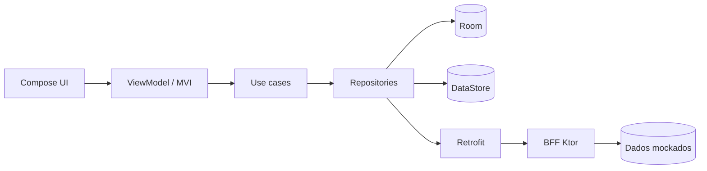

# RFC 0001: Carteira de Benefícios (VR/VA)

| | |
|---|---|
| **Status** | Em implementação |
| **Autor** | Rodrigo Marques Pupe |
| **Data** | 2026-10-23 |
| **Plataforma** | Android nativo (Kotlin) + BFF em Ktor |

## 1. Contexto e problema

Quem recebe vale-refeição/alimentação (VR/VA) costuma ter dificuldade para saber quanto ainda pode gastar no mês, onde o dinheiro está indo e se está dentro do planejado. O saldo existe, mas falta uma visão clara de **extrato, categorias e metas**.

Este projeto propõe um app que mostra o saldo por benefício, um extrato navegável e permite definir **metas mensais de gasto com alertas**.

## 2. Objetivos e não-objetivos

**Objetivos**
- Consultar saldo por benefício (VR e VA).
- Navegar no extrato com filtros (período, categoria) e paginação.
- Definir meta mensal por categoria e ser alertado ao se aproximar do limite.
- Funcionar com dados em cache quando offline.
- Demonstrar práticas de engenharia: arquitetura clara, testes, CI, segurança, observabilidade e rollout progressivo.

**Não-objetivos**
- Integração real com adquirentes, Pix ou meios de pagamento (os dados são mockados no BFF).
- Cadastro/autenticação real de usuários (login simulado + biometria local).
- Suporte a tablets/foldables e múltiplos idiomas.

## 3. Usuários e métricas de sucesso

**Usuário principal:** pessoa que recebe VR/VA e quer controlar os gastos do mês.

| Métrica | Como medir (evento) | Leitura |
|---|---|---|
| Ativação de metas | `goal_created` / usuários ativos | Indica se a feature gera valor |
| Engajamento no extrato | `statement_filter_applied` | Indica se a navegação é útil |
| Confiabilidade | Taxa de erro em `GET /transactions` e crash-free sessions | Qualidade percebida |
| Performance | Tempo até a Home renderizar | Experiência |

## 4. Proposta

### 4.1 Visão geral

### 4.2 App Android
- **Apresentação:** Jetpack Compose + MVI (estado único, intents e effects). Ver ADR-0001.
- **Dados:** repositório *offline-first*: o Room é a fonte da verdade da UI e a rede atualiza o cache. Ver ADR-0002.
- **Preferências e metas:** DataStore.
- **Estrutura:** módulo único `:app` organizado em pacotes "module-like" (`core`, `feature.auth`, `feature.wallet`), com dependências em um só sentido. Ver ADR-0004.
- **Injeção de dependências:** Koin. Ver ADR-0005.
- **Assíncrono:** Coroutines e Flow.

### 4.3 BFF (Ktor)
Camada fina que agrega e adapta os dados para o app.

| Endpoint | Função |
|---|---|
| `GET /balance` | Saldo por benefício |
| `GET /transactions?cursor=&category=&from=&to=` | Extrato paginado e filtrável |
| `GET /feature-flags` | Flags com rollout percentual. Ver ADR-0003 |

### 4.4 Segurança e LGPD
- Biometria para abrir o app; dados sensíveis protegidos com Android Keystore.
- TLS com *certificate pinning*; sem dados sensíveis em logs.
- Mascaramento de dados na UI e coleta mínima (apenas o necessário para a funcionalidade).
- Checklist mapeado ao OWASP MASVS no README.

### 4.5 Observabilidade
- Crashes e erros via **Sentry**, atrás da interface `CrashReporter`.
- Eventos de produto via interface `Analytics`, com implementação inicial em Logcat. A troca por outro provedor (ex.: Firebase Analytics) é feita apenas no módulo de injeção do Koin.
- Eventos nomeados conforme a seção 3.

### 4.6 Rollout
Funcionalidades novas (ex.: metas) ficam atrás de *feature flag* com percentual de exposição, permitindo liberar para uma parcela dos usuários (canary) e desligar sem novo release.

## 5. Alternativas consideradas

| Alternativa | Por que não |
|---|---|
| App sem BFF, consumindo mocks locais | Não demonstraria integração nem agregação de dados |
| Online-only (sem cache) | Pior experiência em redes instáveis e menos interessante tecnicamente |
| Múltiplos módulos Gradle desde o início | Custo de configuração alto para o prazo. Optou-se por pacotes "module-like" com fronteiras e contratos explícitos. Ver ADR-0004 |
| Firebase Crashlytics/Analytics como solução inicial | O `google-services.json` poderia quebrar o build para quem clonar o repositório; Sentry é mencionado na vaga e funciona sem configuração obrigatória |

## 6. Riscos

| Risco | Mitigação |
|---|---|
| Escopo maior que o prazo (3 dias) | Priorizar fluxo principal; cortar itens opcionais primeiro |
| Dados mockados parecerem artificiais | Gerador com seed fixa e categorias realistas |
| Complexidade do offline-first | Começar pelo extrato e manter a regra de sincronização simples |

## 7. Questões em aberto
- ~~Estratégia de invalidação do cache~~ Resolvida: TTL simples com *stale-while-revalidate*. Ver ADR-0002 (atualização de 2026-10-25).
- Necessidade de GraphQL (opcional, só se sobrar tempo).

## 8. Plano resumido

1. Fundação, CI e documentação.
2. BFF e camada de dados.
3. Telas principais (Home, Extrato, Detalhe).
4. Metas, segurança, flags e observabilidade.
5. Acabamento, README e revisão final.
